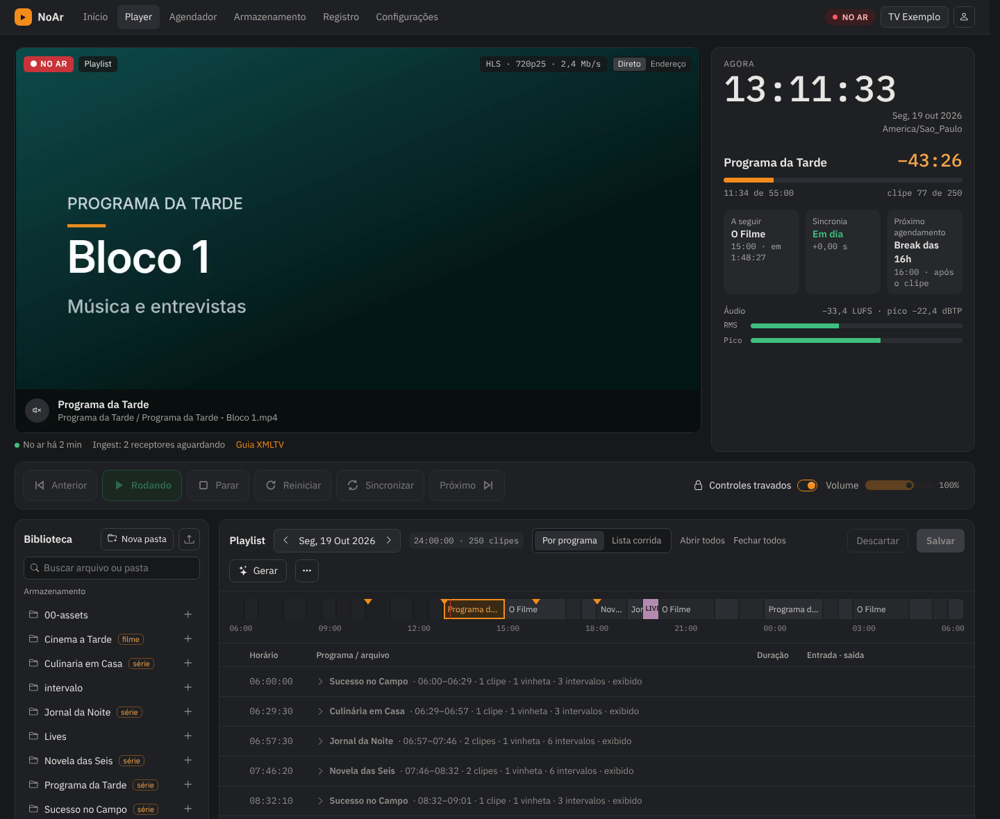
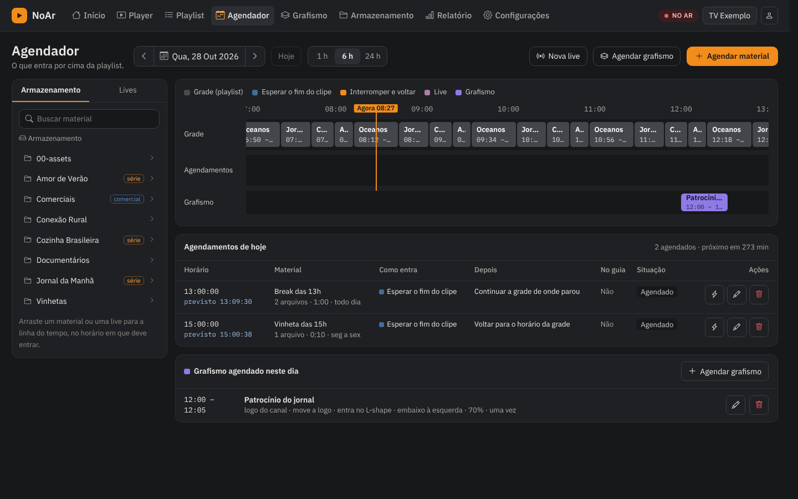
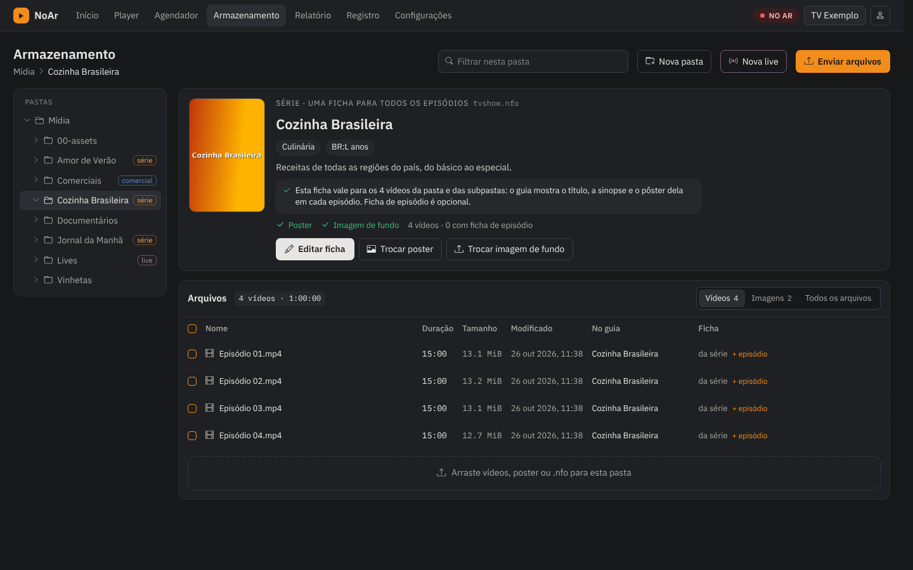
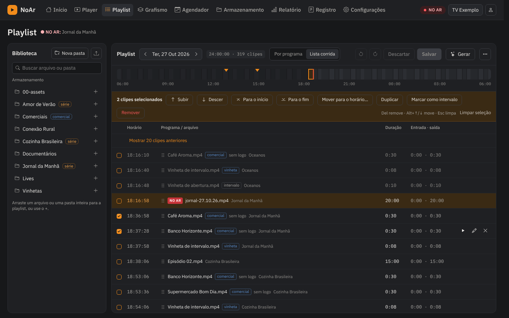
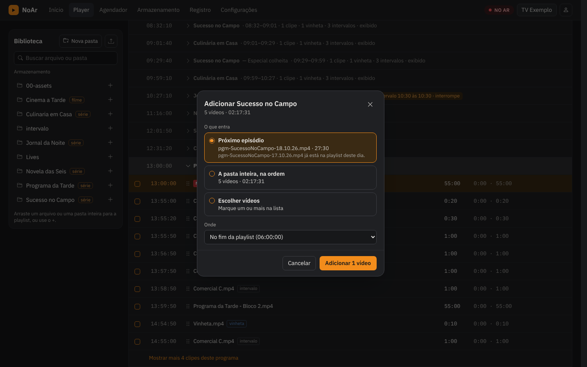
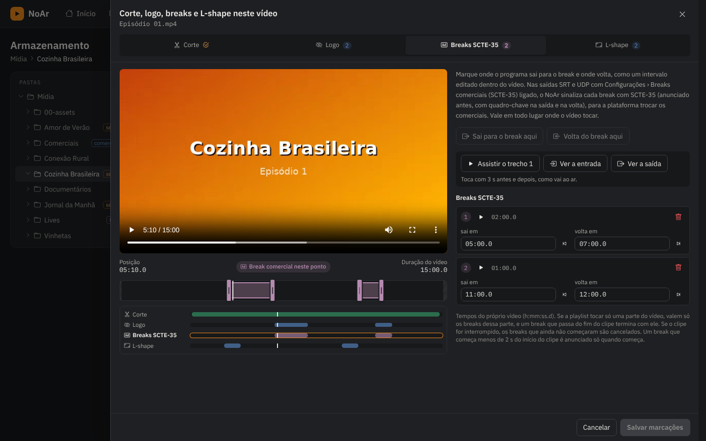
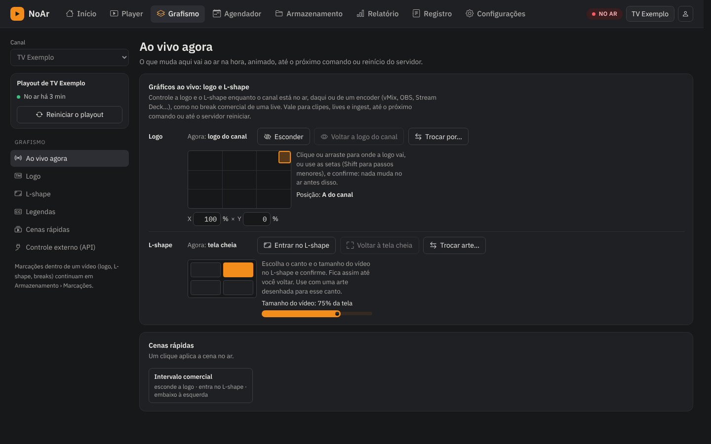
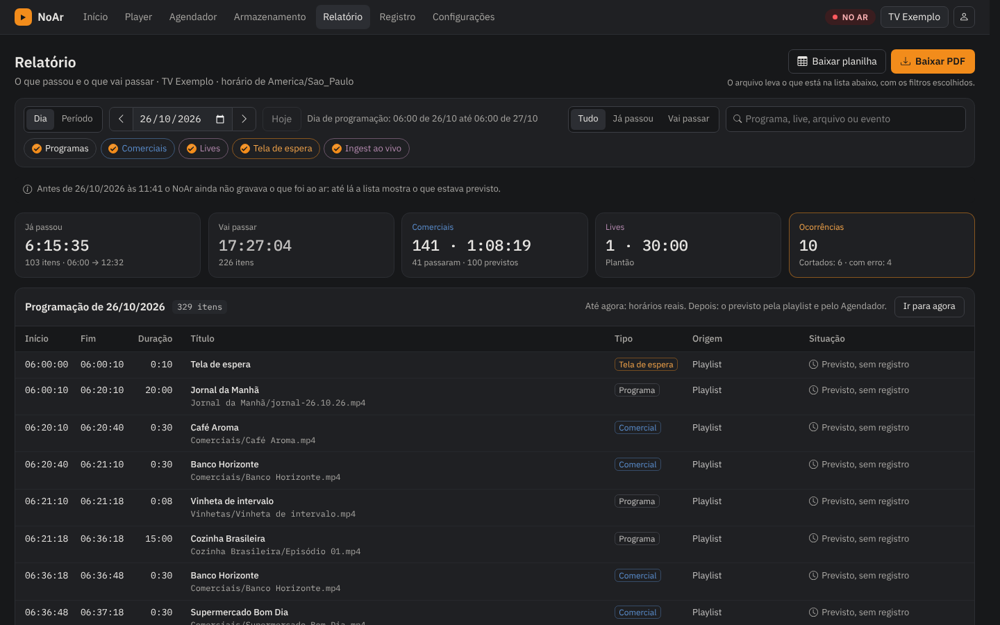
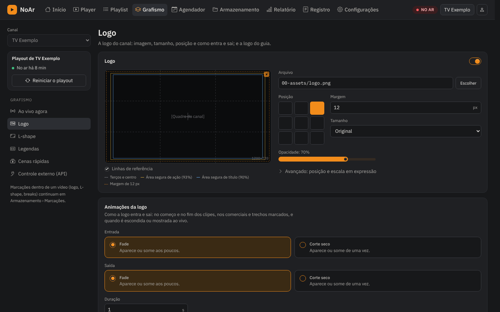

**NoAr**
================

[](https://www.gnu.org/licenses/gpl-3.0)

NoAr is a 24/7 TV playout system: it plays daily playlists or folders without
interruption, lets you schedule breaks and live shows over the running
programme, and publishes an XMLTV guide with artwork for IPTV players.

Everything is run from the browser: the Player for what is on air, the
Playlist page to build the days, the Scheduler for what goes in over them,
Graphics for the logo and the L-shape, Storage for the videos and the guide,
and the Report for what aired.

## Features

**On air**

- **Player**: live preview straight from the output (about a second behind
  the air, for HLS, RTMP or SRT), in a **light** quality for slow connections
  or the output's own; a clock with what is on air and what comes next, the
  next break and scheduled event, the sync state and the audio levels; and
  transport controls that lock against a stray click.
- **Graphics bar** under the preview: switch the logo and the L-shape, move
  them (dragged or typed, confirmed before they go on air), pick the L-shape's
  corner, apply quick scenes and mark a commercial break; it locks like the
  transport.
- **Output that keeps going**: HLS (with adaptive renditions) and SRT, RTMP or
  UDP streams. A destination that is down never stops the channel: NoAr
  reconnects by itself, the preview keeps playing, and the Player says whether
  the output is sending, waiting for a receiver or cannot connect, and why
  ([docs](docs/output.md#when-the-destination-is-down)).
- **Scheduled live sources**: NoAr pulls streams from an external ingest server
  such as MediaMTX and switches between files and live sources through GStreamer
  ([docs](docs/live_ingest.md)).
- **Recording** of the output, loudness normalization and an audio meter.

**Playlists**

- **Playlist** page (its own item in the menu): the library and the day's
  playlist, grouped by program the way the guide names it, filling the
  screen with only the list scrolling. Add files or a whole program folder (its
  next episode, every video in order, or the ones you pick) at the end, after
  the selection or at a time; move, duplicate, mark as a break, with undo,
  keys and how much of the day is still to fill.
- **Per-item edits**: an item's in and out points, title, audio, filter and
  its own **marks** (logo, breaks, L-shape) that apply to that item only and
  leave the video in Storage as it is.
- **Daily playlists** with a custom day start, editable while playing, or
  **folder mode**, which plays the storage folder without a playlist
  ([docs](docs/folder_mode.md)); fillers cover missing clips.
- **Playlist generator**: fill a day from the folders you pick, or block by
  block at set times, as a draft you review before saving
  ([docs](docs/playlist_gen.md)). Playlists can also be imported from text
  or m3u files.
- **Videos from a URL** next to local files ([docs](docs/remote_source.md)).

**Scheduler**

- Place a break, a clip or a live show (SRT, RTMP, HLS) at a time over
  whatever is on air, either waiting for the current clip to end or
  interrupting it and resuming at the exact point, without dropping the
  output; once, every day or on chosen weekdays ([docs](docs/scheduler.md)).
- **Scheduled graphics**: at a time, bring the L-shape in (with its graphic,
  corner and size), hide, swap or bring back the logo (the channel's one too)
  and move it anywhere; undone by itself when the event ends
  ([docs](docs/scheduler.md#scheduled-graphics)).

**Graphics**

- Its own menu tab for the logo, the L-shape and the subtitles. The logo comes
  up and goes off with a fade or a cut, cross-fades when swapped, and goes
  anywhere on the screen (`X% × Y%`).
- **L-shape**: the picture shrinks into a corner over a full-screen graphic,
  with a downloadable template.
- **Quick scenes**: a set of logo and L-shape changes applied in one click,
  from NoAr or an encoder.
- Everything can be hidden, swapped, moved or applied on air from NoAr or by
  API with a fixed key, with a tutorial ([docs](docs/logo.md)).
- **WebVTT subtitles** in the HLS output ([docs](docs/closed_captions.md)).

**Storage**

- Program folders with their guide sheet edited in the browser, poster and
  wide image, and series with one sheet for every episode.
- Uploads that keep going in the background while you work on other pages.
  Uploaded videos can be **converted to the output format** once, so the
  playout does less on air ([docs](docs/uploads.md)), and **trimmed** once, by
  dragging the in and out points while the video plays, so they come in
  trimmed everywhere ([docs](docs/trim.md)).
- **Marks in a video**: its trim, stretches without logo, ad breaks and
  L-shape stretches on one timeline, played back as they air, plus where the
  logo goes and the L-shape's graphic, corner and size for that video.
- **Commercials folders**: mark a folder once and everything in it plays as a
  commercial: out of the guide and without the logo
  ([docs](docs/commercials.md)).

**Ad breaks and the guide**

- **SCTE-35**: runs of commercials, breaks marked by hand, by API from an
  encoder, or inside a programme video are signalled in the SRT or UDP output
  for FAST platforms and ad servers to replace, frame-accurately and announced
  ahead ([docs](docs/ad_breaks.md), [docs](docs/scte35.md)).
- **XMLTV guide** built from the playlists and a Kodi-style `.nfo` file in
  each program folder, with posters, episode images, credits with photos and a
  channel logo of its own ([docs](docs/xmltv.md)).
- **Report**: what aired, with the actual times and how each item ended, and
  what is still to come, for a day or a period; narrowed to one commercial,
  program, live or event, and downloaded as a PDF or a spreadsheet
  ([docs](docs/report.md)).

**Operation**

- **Multiple channels**, users with roles, and a **REST API**
  ([docs](docs/api.md)).
- **Alerts** by mail and HTTP push (ntfy) for log errors
  ([docs](docs/notifications.md)); a **log** that follows the channel live, in
  **Settings › Log**.
- **External tasks**: a script run when a clip starts
  ([docs](docs/external_tasks.md)).
- **Settings**: a side menu of pages, with search, unsaved-change markers, one
  save bar, and a restart of the playout or of the whole of NoAr; updates from
  the browser.
- **Docker-only install**: one command, then a setup page in the browser.

The interface is in Brazilian Portuguese and English; the screenshots show the
Portuguese one.



## Screens

**Scheduler**: the day's grade, the scheduled breaks and a scheduled
graphics event (the L-shape in a corner with the logo moved) on their own
lanes, with the lists below.



**Storage**: a series folder with one sheet for every episode, its poster and
how each video will show up in the guide.



**Playlist**: its own page in the menu, filling the screen; the library and
the list header stay put while the list scrolls. Two clips selected, with
what can be done to them, and how far the day runs over.



**Adding a program to the playlist**: the next episode, the whole folder or
the videos you pick, at the end, after the selection or at a time.



**Marks in a video**: the trim, the logo, the SCTE-35 breaks and the L-shape
on one timeline; here a break edited into the programme, where it leaves and
comes back, next to where the logo goes off.



**Graphics › Live now**: the logo and the L-shape on air, placed by dragging
or typing and confirmed before they move, and the quick scenes.



**Report**: a day with the actual times of what aired and how each item ended; on
the current day, also what is still to come
from the playlist and the Scheduler, with totals for commercials and lives.



**Graphics › Logo**: the logo, where and how large it goes on air, and how
it comes up and goes off.



## Install with Docker

Requirements: Docker with the Compose plugin.

```sh
git clone https://github.com/LuizStSantos/NoAr.git
cd NoAr
docker compose up -d
```

The first run builds the image, which takes a while. When it is up, open
`http://<server>:8787` and complete the setup page: create the admin user and
keep the suggested paths under `/data`.

Everything NoAr stores lives in `./data` next to `docker-compose.yml`:

| Folder | Content |
| --- | --- |
| `data/media` | Media storage: videos, program folders with `.nfo` and artwork |
| `data/playlists` | Daily playlists |
| `data/public` | HLS output |
| `data/db` | Database |
| `data/logs` | Channel logs |

Set your time zone in `docker-compose.yml` (`TZ`, default
`America/Sao_Paulo`). Live source URLs connect to an external server and need no
input ports published by NoAr. More in [docs/docker.md](docs/docker.md).

Update from **Settings › Updates** (with the `noar-updater` service on, see
[docs/docker.md](docs/docker.md#updates)), or on the server:

```sh
docker compose pull && docker compose up -d
```

Forgot the admin password? Set a new one from the server with
`docker exec -it noar noar --user-set`; see
[docs/docker.md](docs/docker.md#forgotten-admin-password).

The Player preview keeps playing even when the SRT or RTMP destination is
down or an SRT listener waits for its receiver; the line under it says how the
output is doing. See [docs/output.md](docs/output.md#when-the-destination-is-down).

## Versions

NoAr follows [Semantic Versioning](https://semver.org); every release is
listed in [CHANGELOG.md](CHANGELOG.md). The images on
`ghcr.io/luizstsantos/noar` are tagged:

| Tag | What it is |
| --- | --- |
| `latest` | The newest stable release |
| `1.1`, `1.1.1` | A release line (gets its fixes) or one exact release |
| `main` | The development build, not for air |
| `sha-…` | One commit, for tests |

To stay on a release line, pin it in `docker-compose.yml`, for example
`ghcr.io/luizstsantos/noar:1.1`. Releases are prepared and published by the
**Prepare release** and **Tag release** workflows; see
[docs/releasing.md](docs/releasing.md).

## Documentation

Each feature has a page in [docs](docs/README.md); for the install you only
need this README and [docs/docker.md](docs/docker.md).

## Development

See [docs/developer.md](docs/developer.md). The workspace has two crates:
`noar`, the server and web interface (the binary is `noar`), and
`noar-engine`, which decodes, composites and encodes.

## License and credits

NoAr is free software under the [GNU GPL v3](LICENSE). It is derived from
ffplayout, by Jonathan Baecker and its contributors, also under the GPL v3;
the original copyright and history are kept in this repository. If you
distribute NoAr, or a modified version, you must make its source code
available under the same license.
