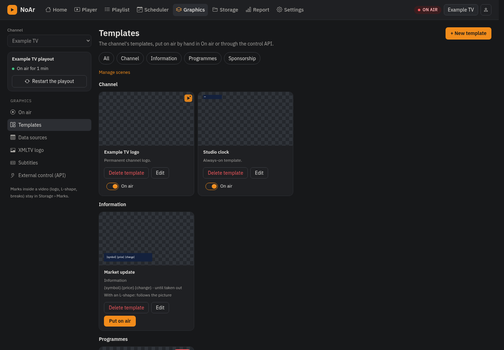
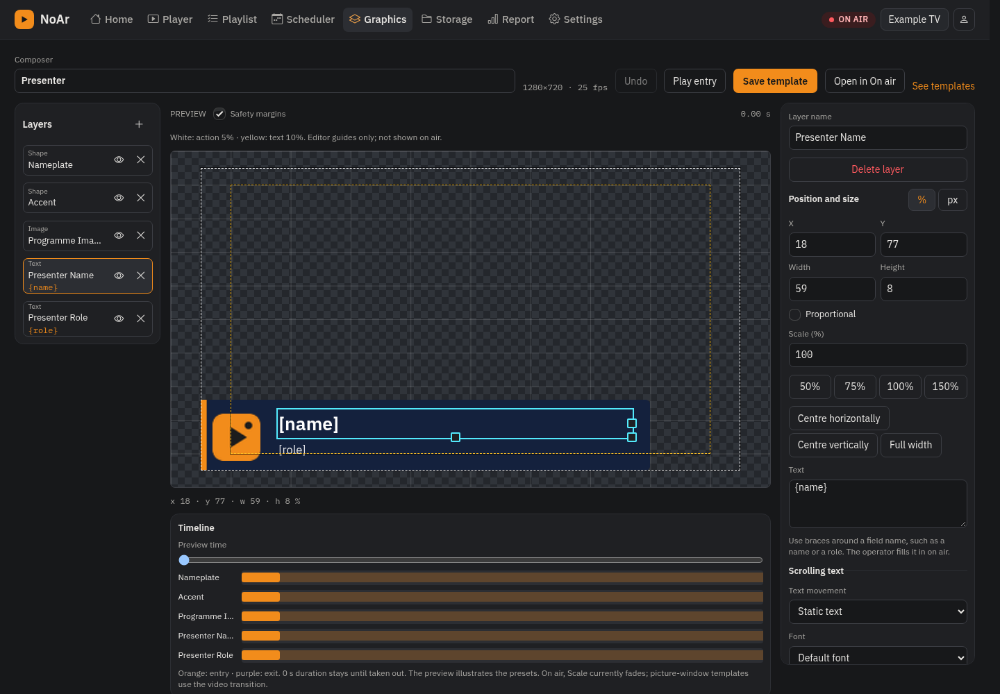
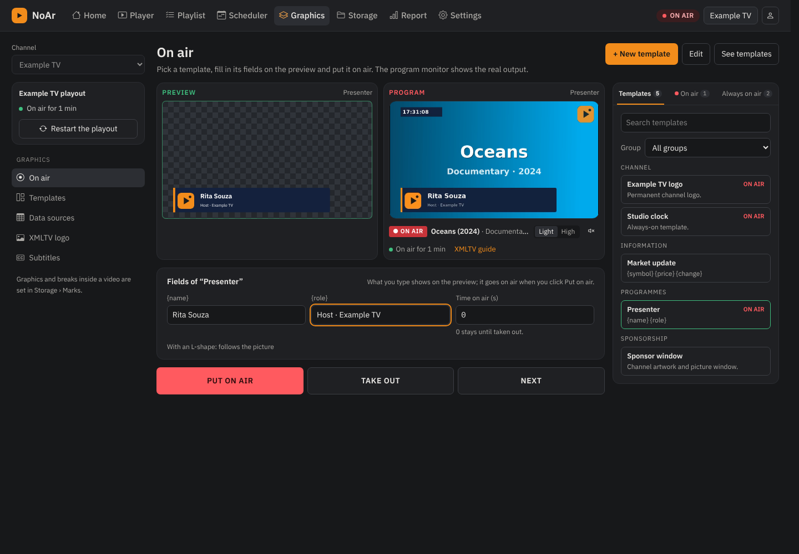
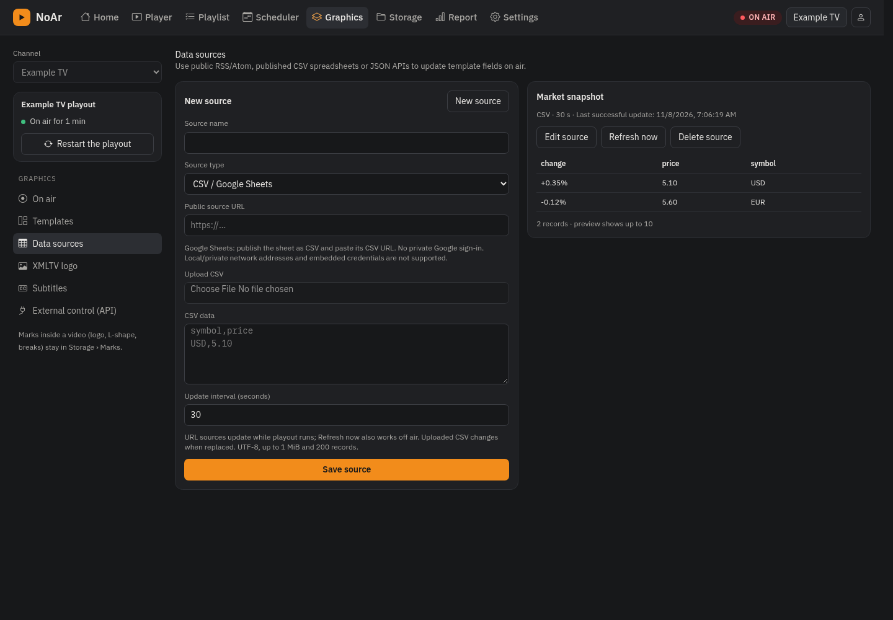

**NoAr**
================

[](https://www.gnu.org/licenses/gpl-3.0)

NoAr is a 24/7 TV playout system: it plays daily playlists or folders without
interruption, lets you schedule breaks and live shows over the running
programme, and publishes an XMLTV guide with artwork for IPTV players.

Everything is run from the browser: the Player for what is on air, the
Playlist page to build the days, the Scheduler for timed programmes and graphics,
Graphics to design and operate reusable templates, Storage for media and guide
artwork, and the Report for what aired.

## Features

**On air**

- **Player**: live preview straight from the output (about a second behind
  the air, for HLS, RTMP or SRT), in a **light** quality for slow connections
  or the output's own; a clock with what is on air and what comes next, the
  next break and scheduled event, the sync state and the audio levels; and
  transport controls that lock against a stray click.
- **Graphics status** under the preview: a read-only list of active channel
  models and temporary graphics, with **Open Graphics** to operate them.
  Graphics › On air has the model preview, program monitor and channel controls.
- **Output that keeps going**: HLS (with adaptive renditions) and SRT, RTMP or
  UDP streams. A destination that is down never stops the channel: NoAr
  reconnects by itself, the preview keeps playing, and the Player says whether
  the output is sending, waiting for a receiver or cannot connect, and why
  ([docs](docs/output.md#when-the-destination-is-down)).
- **Assembled programs**: a program delivered in blocks becomes one file with
  its commercial breaks, dragged into playlists or scheduled as one item, and
  edited once for every airing ([docs](docs/programs.md)).
- **NDI output**: the uncompressed program as an NDI source on the local
  network, once the NDI Runtime is installed on the server
  ([docs](docs/ndi.md)).
- **Video cards**: the program on a Blackmagic DeckLink card (SDI/HDMI), and
  DeckLink or V4L2 capture cards as live inputs
  ([docs](docs/video-cards.md)).
- **Scheduled live sources**: NoAr pulls streams from an external ingest server
  such as MediaMTX and switches between files and live sources through GStreamer
  ([docs](docs/live_ingest.md)).
- **Recording** of the output, loudness normalization and an audio meter.

**Playlists**

- **Playlist** page (its own item in the menu): the library and the day's
  playlist, grouped by program the way the guide names it, filling the
  screen with only the list scrolling. Add files or a whole program folder (its
  next episode, every video in order, or the ones you pick) at the end, after
  the selection or at a time; move, duplicate, mark as a break, with undo,
  keys and how much of the day is still to fill.
- **Per-item edits**: an item's in and out points, title, audio, filter and
  its own **marks** (logo, breaks, L-shape) that apply to that item only and
  leave the video in Storage as it is.
- **Daily playlists** with a custom day start, editable while playing, or
  **folder mode**, which plays the storage folder without a playlist
  ([docs](docs/folder_mode.md)); fillers cover missing clips.
- **Playlist generator**: fill a day from the folders you pick, or block by
  block at set times, as a draft you review before saving
  ([docs](docs/playlist_gen.md)). Playlists can also be imported from text
  or m3u files.
- **Videos from a URL** next to local files ([docs](docs/remote_source.md)).

**Scheduler**

- Place a break, a clip or a live show (SRT, RTMP, HLS) at a time over
  whatever is on air, either waiting for the current clip to end or
  interrupting it without dropping the output. In playlist mode, continue the
  interrupted programme or return to the clock; once, every day or on chosen weekdays ([docs](docs/scheduler.md)).
- **Scheduled graphics**: choose a Composer template, fill its fields or select
  a data-source record, and set its start and end. Temporary graphics leave
  automatically; scheduled visibility changes restore the earlier state
  ([docs](docs/scheduler.md#scheduled-graphics)).

**Graphics**

- **Templates and Composer**: design text, images and animated GIFs, rectangles,
  rounded rectangles, ellipses, lines, live clocks and a video corner as layers.
  Drag, resize in percent or pixels, keep proportions, set opacity and animations,
  and use the timeline, grid and optional safety margins to arrange the design.
  Layers can be hidden, deleted and restored with undo. Open **Edit** or
  **+ New template** from Templates or On air
  ([roadmap and status](docs/graphics-roadmap.md)).
- **Your names and groups**: organize templates by channel, programme, sponsor
  or any group you create. Logo, clock and text compositions can stay **Always
  on air**; optional logo/ticker/L-shape assignments connect models to existing
  channel controls. New installations contain only one removable Logo example.
  Templates can be deleted without returning after restart.
- **Fonts and fields**: upload TTF/OTF fonts from Composer for text and clock
  layers. Add `{fields}` for operators to fill before taking a template on air;
  preview and output use the uploaded font assets.
- **Data sources**: CSV files and public Sheets CSV links, RSS/Atom feeds and
  HTTP JSON supply fields such as prices, scores and headlines. Choose a record,
  refresh it periodically and retain the last good values when a provider fails
  ([docs](docs/graphics-data-sources.md)). Values update in place. Text layers
  can scroll continuously in either direction, with speed and repeat spacing
  set in Composer; this works with manual text and mapped fields.
- **On air**, **Templates**, **Data sources**, **XMLTV logo** and **Subtitles**
  are the Graphics navigation; the graphics key and commands are in
  **Settings › External control**, with the live and SCTE-35 keys. The logo and L-shape
  are edited as layers in Composer. The logo fades or cuts, cross-fades when
  swapped and can go anywhere on screen.
- **L-shape**: the picture shrinks into a corner over a full-screen graphic,
  with artwork layers and an editable video window.
- **Two commands for every graphic**: put a template on air (for a time, or
  until taken off) and take it off, from On air, from cues marked inside a
  video, from the Scheduler, or from an encoder, vMix, OBS or a Stream Deck
  with the graphics key ([docs](docs/logo.md)).
- On air offers a template preview, a real program monitor, put on air / take
  off, and the logo and ticker switches. Edit layers in Composer.
- **WebVTT subtitles** in the HLS output ([docs](docs/closed_captions.md)).

**Storage**

- Program folders with their guide sheet edited in the browser, poster and
  wide image, and series with one sheet for every episode.
- Uploads that keep going in the background while you work on other pages.
  Uploaded videos can be **converted to the output format** once, so the
  playout does less on air ([docs](docs/uploads.md)), and **trimmed** once, by
  dragging the in and out points while the video plays, so they come in
  trimmed everywhere ([docs](docs/trim.md)).
- **Downloads**: save a stored video, image or sidecar file to your computer
  from its row, image card or viewer. WebVTT subtitle files can be uploaded
  beside their videos ([docs](docs/storage.md)).
- **Marks in a video**: its trim, stretches without logo, ad breaks and
  L-shape stretches on one timeline, played back as they air, plus where the
  logo goes and the L-shape's graphic, corner and size for that video.
- **Commercials folders**: mark a folder once and everything in it plays as a
  commercial: out of the guide and without the logo
  ([docs](docs/commercials.md)).

**Ad breaks and the guide**

- **SCTE-35**: runs of commercials, breaks marked by hand, by API from an
  encoder, or inside a programme video are signalled in the SRT or UDP output
  for FAST platforms and ad servers to replace, frame-accurately and announced
  ahead ([docs](docs/ad_breaks.md), [docs](docs/scte35.md)).
- **XMLTV guide** built from the playlists and a Kodi-style `.nfo` file in
  each program folder, with posters, episode images, credits with photos and a
  channel logo of its own ([docs](docs/xmltv.md)).
- **Report**: what aired, with the actual times and how each item ended, and
  what is still to come, for a day or a period; narrowed to one commercial,
  program, live or event, and downloaded as a PDF or a spreadsheet
  ([docs](docs/report.md)).

**Operation**

- **Multiple channels**, users with roles, and a **REST API**
  ([docs](docs/api.md)).
- **Alerts** by mail and HTTP push (ntfy) for log errors
  ([docs](docs/notifications.md)); a **log** that follows the channel live, in
  **Settings › Log**.
- **External tasks**: a script run when a clip starts
  ([docs](docs/external_tasks.md)).
- **Settings**: a side menu of pages, with search, unsaved-change markers, one
  save bar, and a restart of the playout or of the whole of NoAr; updates from
  the browser.
- **Docker-only install**: one command, then a setup page in the browser.

The interface is in English and Brazilian Portuguese. All screenshots below
show **dark mode**, in English, at **1440×1000 pixels**, on the synthetic
**Example TV** demo channel.
Its programmes, artwork, templates and market records are examples.
The [screenshot guide](qa/screenshots/README.md) rebuilds and verifies the gallery.


## Screens

**Scheduler**: the day's programme with each clip at its real length, a
scheduled break and a live on the events lane, and a Composer template scheduled
on its own graphics lane, with the lists below.


**Storage**: a series folder with one sheet for every episode, its poster and
how each video will show up in the guide.


**Playlist**: its own page in the menu, filling the screen; the library and
the list header stay put while the list scrolls. Two clips selected, with
what can be done to them, and how far the day runs over.


**Assembled program**: the blocks of a programme and its commercial break in
one `.program` file, built from the storage pane by dragging or with +; the
playlist and the Scheduler play it as one programme.


**Adding a program to the playlist**: the next episode, the whole folder or
the videos you pick, at the end, after the selection or at a time.


**Marks in a video**: the trim, the logo, the SCTE-35 breaks and the L-shape
on one timeline; here a break edited into the programme, where it leaves and
comes back, next to where the logo goes off.


**Graphics › Templates**: custom groups, thumbnails on a neutral transparency
checkerboard and controls appropriate to each model's assignment. Edit opens
Composer; scroll or filter groups to see the other templates.



**Composer**: image, shape and text layers, named fields, resize handles,
percent/pixel geometry, font upload, animation timing and editor safety margins.
The shared checkerboard gains an alignment grid in the editor.



**Graphics › On air**: fill the presenter fields on the preview, compare them
with the real program monitor, take graphics in/out and control always-on models.
Preview uses the same checkerboard as Templates; Program shows the actual video.



**Graphics › Data sources**: a CSV example with two market records, ready to
map to template fields. RSS/Atom and HTTP JSON sources use the same page.



**Report**: a day with the actual times of what aired and how each item ended; on
the current day, also what is still to come
from the playlist and the Scheduler, with totals for commercials and lives.


**Settings › Output**: HLS, a stream (RTMP, SRT or UDP), NDI or an SDI/HDMI
card as the destination, with the video encoder and the output audio sample
rate.


**Sign in**: what NoAr does, next to the sign-in form.


## Install with Docker

Requirements: Docker with the Compose plugin.

To test the graphics review branch on a disposable machine, follow the
[branch test guide](docs/graphics-testing.md) instead of the published-image
commands below. It builds this checkout and starts a fresh test installation.

```sh
git clone https://github.com/LuizStSantos/NoAr.git
cd NoAr
docker compose pull
docker compose up -d --no-build
```

This downloads the published image (`ghcr.io/luizstsantos/noar:latest`, the
newest release) instead of compiling NoAr on the server. Without
`--no-build`, Compose builds the image from the source when it cannot
download it, which takes a long time; to build on purpose, run
`docker compose build` first. When it is up, open `http://<server>:8787` and
complete the setup page: create the admin user and keep the suggested paths
under `/data`.

Everything NoAr stores lives in `./data` next to `docker-compose.yml`:

| Folder           | Content                                                        |
| ---------------- | -------------------------------------------------------------- |
| `data/media`     | Media storage: videos, program folders with `.nfo` and artwork |
| `data/playlists` | Daily playlists                                                |
| `data/public`    | HLS output                                                     |
| `data/db`        | Database                                                       |
| `data/logs`      | Channel logs                                                   |

Set your time zone in `docker-compose.yml` (`TZ`, default
`America/Sao_Paulo`). Live source URLs connect to an external server and need no
input ports published by NoAr. More in [docs/docker.md](docs/docker.md).

Update from **Settings › Updates** (with the `noar-updater` service on, see
[docs/docker.md](docs/docker.md#updates)), or on the server:

```sh
docker compose pull && docker compose up -d --no-build
```

Forgot the admin password? Set a new one from the server with
`docker exec -it noar noar --user-set`; see
[docs/docker.md](docs/docker.md#forgotten-admin-password).

The Player preview keeps playing even when the SRT or RTMP destination is
down or an SRT listener waits for its receiver; the line under it says how the
output is doing. See [docs/output.md](docs/output.md#when-the-destination-is-down).

## Versions

NoAr follows [Semantic Versioning](https://semver.org); every release is
listed in [CHANGELOG.md](CHANGELOG.md). The images on
`ghcr.io/luizstsantos/noar` are tagged:

| Tag            | What it is                                           |
| -------------- | ---------------------------------------------------- |
| `latest`       | The newest stable release                            |
| `2.2`, `2.2.1` | A release line (gets its fixes) or one exact release |
| `main`         | The development build, not for air                   |
| `sha-…`        | One commit, for tests                                |

To stay on a release line, pin it in `docker-compose.yml`, for example
`ghcr.io/luizstsantos/noar:2.2`. Releases are prepared and published by the
**Prepare release** and **Tag release** workflows; see
[docs/releasing.md](docs/releasing.md).

## Documentation

Each feature has a page in [docs](docs/README.md); for the install you only
need this README and [docs/docker.md](docs/docker.md).

## Development

See [docs/developer.md](docs/developer.md) for builds and
[Architecture and maintenance](docs/maintenance.md) for module ownership and
regression checks. The workspace has two crates:
`noar`, the server and web interface (the binary is `noar`), and
`noar-engine`, which decodes, composites and encodes.

## License and credits

NoAr is free software under the [GNU GPL v3](LICENSE). It is derived from
ffplayout, by Jonathan Baecker and its contributors, also under the GPL v3;
the original copyright and history are kept in this repository. If you
distribute NoAr, or a modified version, you must make its source code
available under the same license.
