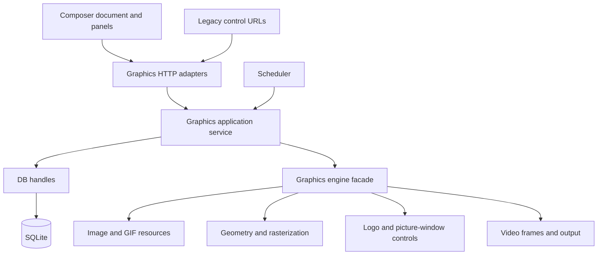

# Graphics architecture and maintenance

This guide describes the source boundaries introduced after the graphics model,
Composer, scheduling, data-source, font and GIF changes. Start with the
[project architecture map](ai/architecture-overview.md), then use this guide for
Graphics. The repository index is a navigation aid; source and tests define behavior.

## Design decision: one Graphics domain

Graphics is one feature domain with specialized implementations. A logo is an
image composition with a compatibility role; an L-shape is artwork plus a
picture window. They share model storage, authoring, takes and application
control. They are not independent settings editors or parallel drawing systems.

The module boundaries follow three established practices:

- [Rust modules and privacy](https://doc.rust-lang.org/book/ch07-02-defining-modules-to-control-scope-and-privacy.html):
  expose a small facade, keep implementation details behind domain modules.
- [Vue composables for code organization](https://vuejs.org/guide/reusability/composables.html#extracting-composables-for-code-organization):
  organize stateful logic by concern; use components for visual layout and
  explicit props/events for communication.
- [Microsoft architectural principles](https://learn.microsoft.com/en-us/dotnet/architecture/modern-web-apps-azure/architectural-principles):
  separate concerns, encapsulate state and make dependencies explicit. These
  principles apply to NoAr's Rust/Vue application without adopting .NET tooling.

The official source documents were consulted for this refactor. Dependency
versions at review: Rust 1.99.1, Axum 0.8.9, Tokio 1.53.2, SQLx 0.9.0,
Vue 3.5.43, Pinia 4.0.3 and TypeScript 6.0.3; runtime GStreamer 1.26.2.



The application exposes `crate::graphics` as a feature module, outside the generic
`utils` namespace. Application services and scheduler code must not call HTTP handlers. The engine
must not import HTTP/SQLite/application dependencies. Database operations stay
in `backend/app/src/db/handles/`; route handlers call those operations instead
of constructing queries. Native frame processing stays in the engine crate.

## Finding the right owner

Paths below are relative to the repository root. Backend graphics implementation
files use the required `graphics.rs` basename; their directories describe their
responsibility. Consumers import Rust module paths rather than disk filenames.

| Responsibility | Source owner |
| --- | --- |
| HTTP model, take, assignment and usage endpoints; shared access policy | `backend/app/src/api/routes/graphics.rs` |
| Font HTTP endpoints | `backend/app/src/api/routes/graphics/fonts/graphics.rs` |
| Data-source HTTP endpoints | `backend/app/src/api/routes/graphics/sources/graphics.rs` |
| Shared control-key comparison | `backend/app/src/api/auth.rs::control_key_matches` |
| Model schema, validation, fields and conversion to engine specs | `backend/app/src/graphics/templates/graphics.rs` |
| Channel bindings, views, visibility and ticker loading | `backend/app/src/graphics/channel/graphics.rs` |
| Take ownership, permanent loading and dynamic refresh | `backend/app/src/graphics.rs` |
| Font and data-provider application services | `backend/app/src/graphics/{fonts,sources}/graphics.rs` |
| Model CRUD and bindings repository facade | `backend/app/src/db/handles/graphics.rs` |
| Projection and compatibility saves | `backend/app/src/db/handles/graphics/compatibility/graphics.rs` |
| Startup conversion and adjacent migration tests | `backend/app/src/db/handles/graphics/compatibility/conversion/graphics.rs` |
| Font and data-source persistence | `backend/app/src/db/handles/graphics/resources/graphics.rs` |
| Clip sidecar metadata, trim and ad-break marks | `backend/app/src/utils/logo_marks.rs` |
| Scheduled event timing and ownership | `backend/app/src/player/graphics_schedule.rs` and `player/graphics_schedule/graphics.rs` |
| Engine composition state and frame composition entry points | `backend/engine/src/compositor/graphics.rs` |
| Rasterization and layer animation/blending | `backend/engine/src/compositor/graphics/rendering/graphics.rs` |
| Shared pixel geometry and masks | `backend/engine/src/compositor/graphics/geometry/graphics.rs` |
| Cached animated image decoding and frame selection | `backend/engine/src/compositor/graphics/images/graphics.rs` |
| Prepared scrolling text strips and clipped repetition | `backend/engine/src/compositor/graphics/scroll/graphics.rs` |
| Specialized logo control/transition implementation | `backend/engine/src/compositor/graphics/logo/graphics.rs` |
| Specialized picture-window control/transition implementation | `backend/engine/src/compositor/graphics/lshape/graphics.rs` |

The old top-level `api/routes/logo.rs` and `compositor/{logo,lshape}.rs` are
removed. Root engine exports such as `LogoControl` and `LShapeControl` remain
available; callers do not need to know the new private compositor layout.

Scrolling is optional layer JSON owned by the template schema, not a channel
setting or a separate ticker renderer. The engine prepares one complete glyph
strip using the shared text/font renderer, then blends clipped references on
each frame. Temporary and permanent composition pass their existing take clock,
so data refreshes preserve elapsed motion. `ScrollingText.vue` approximates that
motion in browser previews; L-shape artwork refresh also inherits the previous
prepared artwork epoch, including model-based replacement and clip artwork.
Composer owns authored timeline time and leaves the
edit canvas static. The Program monitor still shows actual output. See the
[operator/schema guide](graphics-data-sources.md#scroll-text-and-live-information)
The specializations preserve their existing algorithms, synchronization,
transitions and processing order.

## Composer state and component contracts

`frontend/src/components/graphics/GraphicsComposer.vue` is the route entry and
the **single owner** of the editable document, selection, history, load/save,
asset uploads, assignment and stale-request protection. It coordinates panels;
child panels do not fetch/save models or hold another copy of the document.

| Component or helper | Responsibility |
| --- | --- |
| `graphics/composer/ComposerCanvas.vue` | Preview, hit targets, pointer capture, drag/resize patches, snapping and editor-only guides |
| `graphics/composer/ComposerLayerList.vue` | Add/select/visibility/delete commands |
| `graphics/composer/ComposerLayerInspector.vue` | Typed patches for appearance, text, shapes, fonts, clocks and animation; slots for document-owned geometry/media controls |
| `graphics/composer/ComposerFieldMappings.vue` | Source, column and row mapping commands |
| `graphics/composer/ComposerTimeline.vue` | Timeline display and playhead commands |
| `graphics/ScrollingText.vue` | Measured single-line browser preview, automatic animation lifecycle and deterministic Composer playhead rendering |
| `composables/graphicsComposerGeometry.ts` | Percent/pixel conversion, proportional sizing, scale bases and video-window presets |
| `composables/graphicsComposerPreview.ts` | Preview time, animation frame ownership and unmount cleanup |
| `composables/graphicsImages.ts` | Authorized storage image preview URLs |
| `composables/graphicsLegacyGeometry.ts` | Existing scale/position expression geometry for clip-mark compatibility |

Component paths in this table start at `frontend/src/components/`; composable
paths start at `frontend/src/`. Props are inputs and emitted commands/patches are
outputs. The document owner records one undo snapshot per pointer gesture.
Typed inputs and explicit patches keep mutation sources traceable. Editor
checkboxes, snapping guides and the checkerboard never enter saved model JSON.
`TemplatePreview.vue` owns the neutral checkerboard for library cards, On air
Preview and Composer. Composer adds its alignment grid through the shared CSS
background variable, plus optional safe-area guides. Program remains the real
video monitor; preview styling never changes encoded output.

`GraphicsSubtitles.vue` owns the active VTT settings page.
`GraphicsControlApi.vue` owns the existing controller key/examples within the
API page. The unreachable `SettingsLogo.vue`, `LShapeSettings.vue`,
`GraphicsTicker.vue` and the unused live-control branch of `LogoRemote.vue`
are removed. XMLTV remains in `GraphicsGuideLogo.vue`; editing a channel model
opens Composer. VTT fields retain the existing configuration save contract. Clip sidecars retain
their existing `LogoMarks` wire shape and legacy file readers: those records
also contain trim, ad breaks and program insert metadata, rather than another
channel-logo renderer.

## State, concurrency and compatibility

- Authored layer definitions live in graphics model storage; assignments link
  channel roles to models. `project_channel_graphics` creates the compatibility
  processing view used by existing engine/API controls. Do not introduce a
  second authoring path into frozen legacy database columns.
- HTTP adapters own authorization and response serialization. Shared application
  operations return ordinary values, not Axum `Json` wrappers. Scheduler events,
  clip cues and HTTP requests put templates on air and off through the same take
  and out commands.
- Definition edits invalidate queued/prepared takes; runtime visibility controls
  and take publication serialize without invalidating unrelated waiting commands.
  Preserve generation checks across asynchronous work and final publication.
  Lifecycle cancellation must not wait for image decoding. Do not hold a
  database/configuration or frame-critical control lock during native decoding.
- Composer creates/updates content and optional channel assignment atomically;
  database helpers own the single transaction, including demotion of a replaced
  permanent model. Display localization never rewrites converted saved names.
- A failed optional permanent artwork load is isolated from healthy models.
  Database errors still propagate; do not report a broken database as an absent
  optional image.
- A scheduled temporary graphic owns a take ID. End/removal must retire only
  that take; permanent visibility uses the existing overlapping-event leases.
- GIF caches, decode limits and phase behavior are documented in the
  [operator guide](logo.md#image-sizing-and-animated-gif-or-webp). Moving code must not
  introduce per-frame decoding or reset the animation during a visibility change.
- The keyed `/graphics/{id}/...` URLs, response DTOs, key header, errors and
  authentication policy are compatibility contracts (the `/logo`, `/lshape` and
  `/scene` routes were removed in 3.0). Internal names can change; wire names and
  migration checksums cannot change incidentally.

## Making common changes

### Add or change a layer property

Start with `templates/graphics.rs` for validation and serialized defaults.
Update the frontend model in `composables/graphicsTemplates.ts`, its inspector,
`TemplatePreview.vue` and the engine layer spec/rasterization together. Preserve
old defaults. Exercise save/reload, Undo and actual encoded output for any
rendering change. A CSS browser preview is not output evidence.

### Add a controller command or scheduled behavior

Implement shared behavior in the graphics application service, then adapt the
HTTP DTO or scheduler trigger. Keep key/role/channel checks at the HTTP boundary.
A scheduler must never import a route module. Verify ownership, overlap, manual
intervention, reversal, restart and the retained legacy HTTP comparison cases.

### Add storage or conversion behavior

Use DB handles and bound parameters. Add a new normal SQLx migration only when
the schema changes. Keep released migrations immutable. Test conversion with the
real migrations on disposable SQLite, including repeat conversion and edited
models. Follow the existing pre-migration backup/restore procedure.

### Move modules or rename functions

Keep domain facades stable where consumers depend on them. Move adjacent tests
with the behavior they describe. Update imports, repository map, this ownership
guide and relevant developer links. Do not rename transport fields merely to
match an internal symbol. Review default-feature and desktop-gated consumers.

## Verification and architectural enforcement

The CI `Validate` workflow runs the lightweight boundary checker and its tests:

```sh
python3 qa/architecture/check.py
python3 -m unittest discover -s qa/architecture -v
```

This scans application/engine Rust source for service-to-HTTP dependencies,
SQL outside the data layer and engine imports of application-only dependencies.
It masks comments/quoted text and excludes individual `#[cfg(test)]` items,
including when production definitions follow them. It is
a lexical tripwire, not a complete Rust dependency analyzer; Cargo and runtime
verification remain required. `--json` emits a machine-readable evidence record.

For backend refactors run fmt, denied-warning no-default/all-target Clippy,
the full no-default suite and applicable desktop-feature compilation. Frontend
refactors require Vue types, ESLint, Prettier, build and actual disposable browser
flows. Rendering changes/moves also repeat deterministic frame/HLS proof;
scheduler changes need timed on/off and ownership evidence.

The inventory covers the whole project structure; the implementation targets
verified coupling and duplicated/unreachable graphics paths introduced or exposed
by these changes. Larger unrelated modules such as desktop device presentation,
playlist editing and general output configuration keep their existing owners.
Their size alone does not justify changing timing-sensitive or unrelated logic.

## Processing measurement boundaries

With `processing-bench`, `graphics_blend` sums the disjoint temporary, permanent,
role-logo and animated L-shape artwork blend scopes. Several scopes execute per
output frame, including empty loops: average per-call time is not the cost of
one complete frame. Use total measured time over observed output frames and
whole-process CPU/RSS for comparisons. Native preparation, asynchronous data
fetching, L-shape video scaling/copying, and encoder/muxer work are outside this
stage. Normal builds use the existing inline no-op benchmark wrappers.
