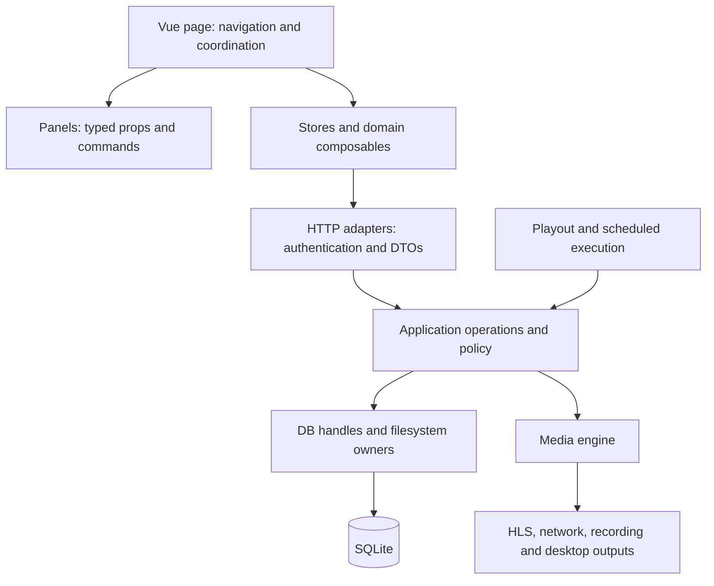

# NoAr architecture and maintenance

This guide records the organization of the Rust application, media engine and
Vue frontend. The [verification handoff](maintenance-handoff/README.md) records
what was changed, executed and left untested. The indexed
[repository map](ai/repository-map.md) helps locate symbols; source code remains
authoritative. Graphics has an additional [domain guide](graphics-maintenance.md).

## Boundaries and state ownership

A page coordinates a workflow. The extracted presentational panels receive
data and emit commands; they do not create another saved document, call the API or import a store. Domain composables own the extracted request/dialog/resource lifecycle.
Stores remain the shared owners of channel configuration and playlist drafts.
Keep asynchronous response guards, loading failures, undo history and dialog
focus management with their existing workflow owner.

HTTP adapters authenticate, authorize channel/resource access, validate request
boundaries and serialize responses. Reusable operations belong in application
services, not route handlers. Only DB handles execute production SQL. The engine
owns native media processing and has no dependency on Axum, SQLx or app state.
Feature-specific specializations remain useful when their timing/lifecycle is
different; a single large generic module is not a maintenance goal.

## Source owners

Paths are relative to the repository root.

| Domain | Frontend owner | Application/data owner | Engine or supporting owner |
| --- | --- | --- | --- |
| Sessions and permissions | `stores/auth.ts`, `composables/authFetch.ts`, router guards | `api/auth.rs`, middleware, user/refresh-token handles | JWT/session policy remains at the application boundary |
| Channel configuration | `stores/config.ts`, `stores/settings.ts`, `composables/settingsPage.ts` | `api/routes/playout_config.rs`, `utils/config.rs`, configuration/output handles | `utils/config.rs` in the engine is a stable output-configuration facade |
| Output/recording policy | `components/settings/SettingsOutput.vue`, `composables/videoDevices.ts` | `utils/config/{output,recording,update}.rs` | `utils/config/{codecs,hls,metadata,recording}.rs` |
| Storage and uploads | `views/MediaView.vue`, `composables/storageFileActions.ts` | `file/{mod,local,upload}.rs`, file-access tickets and file routes | Conversion/probe services use the engine |
| Storage images | `composables/storageImages.ts`, `StorageImageGrid.vue`, `ImageViewer.vue` | Existing scoped file-access routes | Preview URL lifetime and stored-file downloads remain separate actions |
| Programme sheets and clip marks | Storage sheet/program/mark editors and existing composables | `utils/xmltv/sheet.rs`, `utils/logo_marks.rs`, filesystem sidecars | Saved trim/ad/graphics marks are consumed by playout |
| Playlist editing | `components/player/PlaylistPanel.vue`, `composables/playlistRows.ts`, `playlistDayActions.ts` | Playlist routes and file persistence | `player/input/playlist.rs` consumes authored playlists |
| Scheduler UI | `views/ScheduleView.vue`, `components/schedule/ScheduleTimeline.vue`, event/graphics lists | Schedule routes/handles and recurrence helpers | `player/schedule.rs` owns eligibility/queue/resume policy |
| Scheduled playback | Schedule dialogs and parent drafts | `player/schedule/playback.rs` owns clip/live execution and restoration | Preloader, input and playback controls keep media timing |
| Player and live control | Player components, transport/status stores, live components | `player/controller.rs`, control/live routes and shared operations | `playout.rs`, `playback_control.rs`, native inputs |
| Graphics | Composer, On air, model/source/font composables | `graphics/`, graphics DB handles and HTTP adapters | `compositor/graphics/`; see the dedicated maintenance guide |
| Reports and as-run | `views/ReportView.vue`, `composables/reportData.ts`, existing report/export helpers | Report routes, `utils/report.rs`, as-run handles | Engine timestamps reach application as-run coordination |
| XMLTV | Guide-logo and programme sheet UI | `utils/xmltv/mod.rs` assembles programmes; `document.rs` serializes XML | Public URLs, XML escaping and channel timezone belong to the document contract |
| Audio | Existing audio settings and meter components | Config update reconciles live controls after persistence | `audio_mixer/` and `analysis/` own DSP and metering |
| Desktop/recording | Output/recording configuration | Playout selects output and supplies callbacks | `output/desktop/recording.rs` owns the bounded recording worker; desktop renderer owns UI/audio clocks |
| Deployment and upgrades | Setup/updater UI | Existing setup/update/backup services | Docker, native dependency scripts, CI and release workflows remain separate owners |

In frontend columns, unqualified paths start at `frontend/src/`; application
paths start at `backend/app/src/`, and engine paths at `backend/engine/src/`.
The same filename in two crates does not mean duplicated policy: application
configuration describes persisted/operator settings, while engine configuration
validates and constructs native output settings.

## Sensitive flows

**Configuration save:** the HTTP route checks authority/channel access and finds
the manager, then calls `apply_config_update`. The operation acquires the
existing graphics edit guard, validates assets, encoders and recording, persists
through DB handles using the existing transaction, and reconciles runtime
mail/audio/graphics state in the established order. Restart-required state is
computed against the running output, not just the previously saved draft.
Keep error strings, response DTOs and commit/reconciliation order stable.

**Playlist save:** `playlistDayActions.ts` retains the loading/load-failure
checks, empty-day confirmation, serialization cleanup and conflict handling.
`playlistRows.ts` derives presentation rows/groups/windows from the shared
playlist draft; it does not own another playlist. A failed load must never allow
a stale draft to overwrite another day.

**Schedule execution:** `player/schedule.rs` keeps occurrence selection,
reservation, generation checks, interruption/resume policy and cancellation.
Its playback child executes clips/lives and returns to programme playback.
The UI timeline handles coordinates/scrolling/native drag events and emits a
semantic drop payload plus seconds; the parent owns drafts and API writes.
Do not replace channel/source time with browser wall time in media decisions.

**Storage:** `MediaView.vue` owns channel/folder navigation, selection and
upload/program/live orchestration. `storageFileActions.ts` owns mutation and
dialog state and fresh-ticket downloads. `storageImages.ts` owns cached preview
URLs and viewer selection. Retain scope checks, sanitization, no-overwrite upload
finalization, retries, cache invalidation and route-change protection.

**Report refresh:** `reportData.ts` owns request tickets, loading, current-range
polling and timer disposal. The view owns period/filter selection and export
presentation. The newest request owns the result; failed foreground reads clear
exportable data, while quiet refresh failures preserve the current report.

**Native output:** codec defaults/capability checks, HLS parsing, metadata bounds
and recording configuration have dedicated owners behind the stable engine
configuration facade. Desktop recording keeps its bounded queue, worker,
backpressure and finish behavior together. Keep frame/sample/PTS units,
thread ownership, queue limits and shutdown order explicit.

## Extending a domain

1. Locate the owning route/service/store through the map and source table.
2. Keep one authoritative draft/control and pass typed values/commands across
   UI boundaries. Reuse existing authentication, file-access and DB helpers.
3. Put policy with its domain; leave native caps/processing in the engine.
4. Preserve public exports, serialized defaults, URL shapes, error responses,
   migration checksums, clock units and resource cleanup unless a behavior
   change is explicitly requested.
5. Run the matching checks below and update the handoff with observed evidence.

## Verification and references

Run `python3 qa/architecture/check.py` and
`python3 -m unittest discover -s qa/architecture -v` after changing boundaries.
CI already runs these checks. The checker guards application/engine/SQL edges
and direct store/network dependencies in the extracted presentation panels.
It is a scoped source tripwire; Rust/Vue builds and runtime tests verify more.

For Rust changes, run fmt, the branch's no-default/all-target Clippy command and
`cargo test --no-default-features` with GStreamer 1.26. Compile/test the affected
feature gates too, especially desktop output. Vue changes require type checking,
ESLint, changed-file Prettier and a production build. Operator workflows require
real browser actions against disposable SQLite; media changes require actual
output, logs and health evidence. See [developer setup](developer.md), the
[isolated browser harness](../qa/e2e/README.md) and the handoff for exact results.

The organization follows [Rust module visibility](https://doc.rust-lang.org/book/ch07-02-defining-modules-to-control-scope-and-privacy.html),
[Vue composable ownership](https://vuejs.org/guide/reusability/composables.html)
and explicit [separation of concerns](https://learn.microsoft.com/en-us/dotnet/architecture/modern-web-apps-azure/architectural-principles).
These principles guide boundaries rather than prescribing a framework rewrite.
