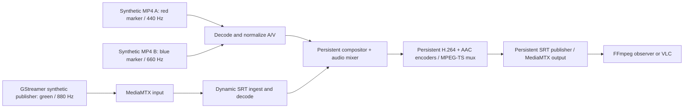

# Isolated GStreamer continuity prototype

This experiment evaluates a possible future NoAr media backend. It does not run
NoAr, use its database, or change its Rust engine, Vue interface, production
Compose file, release workflows or installed versions. Python controls the
experiment; GStreamer performs playback, decoding, composition, mixing, encoding
and SRT transport. FFmpeg generates synthetic files and independently captures
and checks the resulting stream.

This prototype uses the GStreamer `libav` plugin for some codecs (`avenc_aac`
and automatically selected decoders). Those codecs still use FFmpeg libraries.
The experiment replaces pipeline control and transport with GStreamer; it does
not demonstrate removing every FFmpeg library from the final image.

## Run the automated test

To obtain only this experiment on a test server, use a separate checkout:

```sh
cd ~
git clone --depth 1 --filter=blob:none --sparse --branch prototype/gstreamer-continuity \
    https://github.com/LuizStSantos/NoAr.git noar-gstreamer-prototype
cd noar-gstreamer-prototype
git sparse-checkout set qa/gstreamer
cd qa/gstreamer
./run.sh test
```

This creates a new directory beside the existing NoAr checkout. It does not
change the existing installation or its checked-out branch.

Prerequisites: Linux with Docker Engine and Docker Compose v2, Internet access
for the initial image build, and several GB of free disk space. The recovery
test also needs Python 3 on the host. Run these commands from this directory:

```sh
./run.sh test
```

The first run builds `noar-gstreamer-prototype:local`, pulls MediaMTX 1.15.3,
and generates two 180-second synthetic MP4 files. Later runs reuse them.
The default test lasts about 77 seconds plus startup and analysis. It performs
three cycles of file A → file B → SRT live → file B. Each phase lasts six
seconds after a five-second warmup. Live ingest is connected before its turn
and **closed after every return**. The output encoder, muxer and SRT connection
remain running; automatic output reconnection is disabled so a disconnect fails
the experiment.

The runner prints `artifacts/report.json`, returns nonzero on failure, saves
Compose logs and removes only this experiment's containers/network when done.
Files and captures remain available for inspection. A `PASS` describes this
bounded experiment, not readiness to replace NoAr's production engine.

## Simulate source loss and recovery

```sh
./run.sh recovery
```

This stops only the experiment's synthetic `source` service during the first
live phase, then restarts it. The media pipeline must return to file B, retain
the output connection and successfully enter live again in subsequent cycles.
The interruption is recorded in `artifacts/fault.json`. This does not test
failure/restart of MediaMTX or the output network.

## Watch with VLC

```sh
./run.sh watch
```

On the same machine, open:

```text
srt://127.0.0.1:19890?streamid=read:output
```

The demonstration runs three cycles and stops automatically. There is no NoAr
web UI in this prototype. Watch mode disables the automated observer, allowing
VLC to be the reader. Avoid adding VLC to an automated test: that test expects
exactly one observer connection.

For a different computer on your test network, explicitly expose only this
experiment's SRT port:

```sh
NOAR_GST_BIND_IP=0.0.0.0 ./run.sh watch
```

Replace `127.0.0.1` in VLC with the test server's address. Access from outside
the company also requires forwarding **19890/UDP** on the router. The synthetic
stream is unauthenticated; expose the port only for the test, then remove the
forwarding rule. The monitoring API is never published to the host. Production
ports 8787/8890 and the previous staging ports 18787/18890 are not used.

`NOAR_GST_SRT_PORT` can change the host port. `NOAR_GST_CYCLES` accepts 1–5 for
normal/watch runs; the recovery run always uses three. The fixed fixture length
bounds the experiment; automatic playlist looping and Continue mode are not
implemented. Files advance continuously on the clock, including while hidden.

## Architecture and evidence



The compositor and audio mixer operate on the shared live clock. Their latency
budget is reserved before live ingest is added. A stalled input does not stop
output aggregation; a watchdog selects file B if live audio or video stops.
All inputs are decoded concurrently in this first prototype. Production CPU,
memory and synchronization requirements need separate measurements.

The automated observer checks actual decoded color markers and audio tones in
the expected order for **every cycle**, not just the controller's switch logs.
It also checks positive DTS increments, video gaps ≤120 ms, audio gaps ≤100 ms,
end-of-capture A/V timestamp difference <200 ms, one MediaMTX output publisher
and reader ID, reported SRT packet drops, receiver progress and error-free
decoding. These are coarse experiment gates, not a lip-sync certification or
a measurement of all network packet loss. See `verify.py` for exact thresholds.

Generated evidence is ignored by Git:

- `artifacts/events.jsonl`: switches, ingest lifecycle and controller errors.
- `artifacts/capture.ts`, `capture.log`, `decode.log`: received MPEG-TS and diagnostics.
- `artifacts/connections.json`: sampled MediaMTX session IDs and SRT statistics.
- `artifacts/report.json`: gate results, timestamps, source markers and versions.
- `artifacts/compose.log`: service logs saved by the runner.

Each run replaces these files. Copy the evidence elsewhere before rerunning if
you need to retain a previous result.

Run the observer's adversarial unit tests without GStreamer:

```sh
python3 -m unittest discover -s . -p 'test_*.py' -v
```

The Dockerfile uses Debian trixie packages, independent of NoAr's production
dependencies. It does not upgrade or replace NoAr's SRT library. Package versions
are included in the runtime report. BuildKit can use an optional `proxy_ca`
secret; `run.sh` supplies it when `CODEX_PROXY_CERT` is configured, without
embedding the certificate in the image or disabling TLS validation.

## Cleanup

```sh
./run.sh down
```

After reviewing the evidence, remove this directory's `fixtures/` and
`artifacts/` if no longer needed. The optional test image can be removed with
`docker image rm noar-gstreamer-prototype:local`. Do not use Docker system prune
or remove shared MediaMTX images to clean up this experiment.

## Remaining migration work

NoAr integration in Rust, scheduler Clock/Continue semantics, playlist looping,
API/configuration compatibility, preview, graphics/logo/text, audio processing,
recording, HLS, SCTE-35, hardware encoding, output-network recovery, resource
benchmarks, VLC observation and long-duration soak tests remain separate work.
Keep the current FFmpeg backend available throughout any future integration.

Official references consulted (verify against the installed runtime):
[compositor](https://gstreamer.freedesktop.org/documentation/compositor/index.html),
[audiomixer](https://gstreamer.freedesktop.org/documentation/audiomixer/audiomixer.html),
[srtsrc](https://gstreamer.freedesktop.org/documentation/srt/srtsrc.html),
[srtsink](https://gstreamer.freedesktop.org/documentation/srt/srtsink.html).
